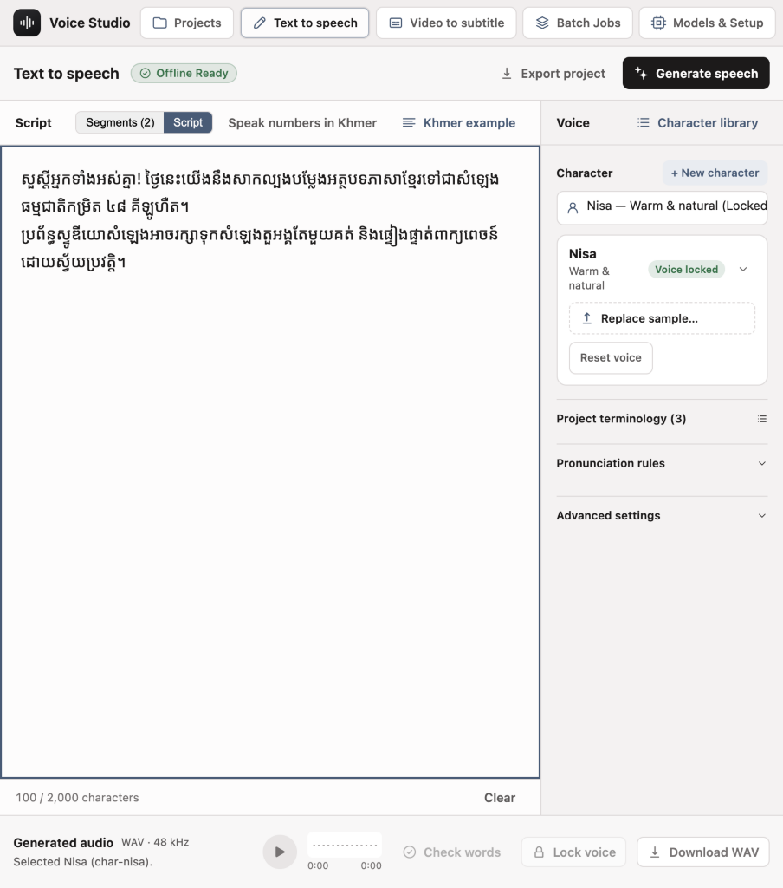
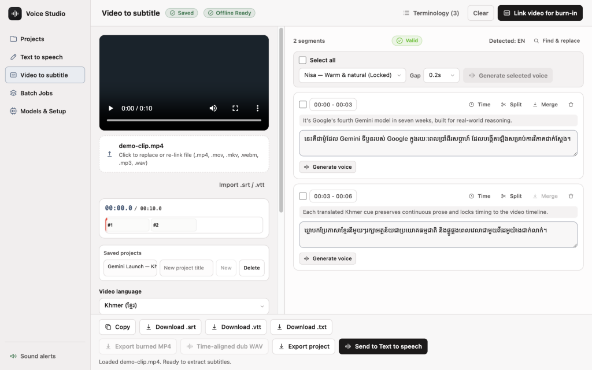

# Voice Studio · VoxCPM2

Offline Apple Silicon **Text-to-Speech** and **Multilingual Video-to-Subtitle Studio** that keeps the upstream open-source [OpenBMB/VoxCPM](https://github.com/OpenBMB/VoxCPM) engine strictly separated from our custom frontend and media subtitle pipeline.

## Preview

### Text to Speech (Khmer & Multilingual · 48 kHz)


### Video to Subtitle (101 Sources · 202 Translation Targets · Per-Frame TTS Voiceover)


## Highlights

- **Text to Speech (`web/` + `engine/`):** High-quality Khmer & multilingual speech synthesis via VoxCPM2 (`48 kHz`), reusable Character Library, 1-person voice locking/anchoring, Khmer number/currency expansion, `-16 LUFS` FFmpeg mastering, and on-demand / optional auto Whisper Khmer round-trip word QA (`seanghay/whisper-small-khmer-v2`).
- **Video to Subtitle (`media/` + `web/`):**
  - **101 source languages** (`Auto-detect` + all 100 Whisper languages via `mlx-community/whisper-large-v3-turbo`, plus `seanghay/Qwen3-ASR-0.6B-Khmer` for Khmer with automatic selective fallback and optional full double-check via `seanghay/whisper-small-khmer-v2`).
  - **202 offline translation targets** (all Meta NLLB-200 FLORES-200 languages, any-to-any including Khmer → any language and RTL support).
  - Optional offline speaker diarization (`sherpa-onnx` Pyannote + 3D-Speaker), live VTT preview, inline timing/split/merge/find-replace editing, and `libass` burned-in MP4 export.
- **Inline & Batch Subtitle Frame Text-to-Speech:** Select individual or multiple subtitle frames, pick any Voice Studio character, generate & play WAV voice clips per frame, and download a combined stitched WAV voiceover right below the subtitle list.

## Repository Layout

- **`web/`** — React + Vite **Voice Studio** UI, persistent Docker storage API (`8090`), nginx proxy (`8087`), and Node test suite (tracked in this repo). See [web/README.md](./web/README.md).
- **`media/`** — Offline Apple Silicon FastAPI service (`8810`) for ASR, speaker diarization, 3-layer Khmer dictionary correction, 202-language NLLB translation, and `libass` MP4 burn-in (tracked in this repo). See [media/README.md](./media/README.md).
- **`engine/`** — Unmodified upstream clone of [OpenBMB/VoxCPM](https://github.com/OpenBMB/VoxCPM) (git-ignored, installed automatically by `./setup.sh` and updated safely via `./update-engine.sh`).

---

## Fresh Machine Setup (macOS Apple Silicon)

**Prerequisites:** `git`, [`uv`](https://docs.astral.sh/uv/), `node` (v20+), [Homebrew](https://brew.sh/), and [Docker Desktop](https://www.docker.com/products/docker-desktop/).

```sh
git clone https://github.com/Sokphirun99/voxcpm2-voice-studio-web.git
cd voxcpm2-voice-studio-web && ./setup.sh
```

What `./setup.sh` does automatically (safe to re-run anytime):
1. Clones `https://github.com/OpenBMB/VoxCPM.git` into `engine/` pinned to the verified compatible commit (`300e426`) on branch `main` tracking `origin/main` (pass `--latest` to track upstream HEAD immediately).
2. Installs `ffmpeg-full` (with `libass` subtitle burn-in support) via Homebrew if missing.
3. Syncs `engine/.venv` and `media/.venv` (Python 3.12 + `qwen-asr==0.0.6 --no-deps`) and installs `web/node_modules`.
4. Starts the persistent background services (`8808` & `8810`) and Voice Studio container (`http://127.0.0.1:8087`).

Other setup options:
```sh
./setup.sh --check          # check prerequisites & installed environments without modifying anything
./setup.sh --no-start       # install everything without launching services yet
./setup.sh --latest         # clone OpenBMB/VoxCPM at latest origin/main
./setup.sh --skip-web-npm   # skip host npm ci if running frontend via Docker only
```

> **First run:** Pretrained AI models (VoxCPM2, Whisper Large-v3-Turbo, Qwen3-ASR-0.6B-Khmer, Whisper Small Khmer v2 verifier, NLLB-200-600M, Sherpa-ONNX diarization) download automatically on first use into `~/.cache/huggingface/` and `~/.cache/voxcpm-media/`.

---

## Daily Commands

```sh
./studio.sh start     # start engine (8808), media service (8810), and Voice Studio (8087)
./studio.sh status    # verify launchd daemons, Docker containers, and proxy HTTP health
./studio.sh restart   # restart native services and rebuild/recreate Docker containers
./studio.sh logs      # tail engine & media logs (logs/*.log)
./studio.sh stop      # stop native services and Docker containers
./studio.sh backup    # back up the Docker volume to ./backups/voice-studio-<timestamp>.tar.gz
./studio.sh restore <backup.tar.gz>  # restore a backup (prompts before replacing data)
```

### Updating Upstream Open-Source `engine/`

Never edit files inside `engine/`. Use `./update-engine.sh` (see [AGENTS.md](./AGENTS.md) for the contract checklist):

```sh
./update-engine.sh --check          # preview incoming OpenBMB/VoxCPM commits & contract diffs
./update-engine.sh                  # fast-forward pull, rebuild engine/.venv, run tests, restart stack
./update-engine.sh --rollback <SHA> # roll back safely if an upstream change breaks compatibility
```

### Running Tests & Disk Cleanup

```sh
npm --prefix web test && npm --prefix web run build
media/.venv/bin/pytest -v media/tests
./cleanup.sh --unused --dry-run     # preview unused model/cache cleanup (see CLEANUP.md)
```

### Backing Up & Restoring Voice Studio Data

Characters, locked voice anchors, and generated audio live in the Docker volume `voxcpm_voice_studio_data` (declared in `web/compose.prod.yaml`).

```sh
./studio.sh backup                                 # ./backups/voice-studio-YYYYMMDD-HHMMSS.tar.gz
./studio.sh backup ~/Desktop/voice-studio.tar.gz   # custom output path
./studio.sh restore ./backups/voice-studio-20260101-120000.tar.gz
./studio.sh restore ./backups/voice-studio-20260101-120000.tar.gz --yes   # non-interactive
```

`backup` streams the volume from an ephemeral container mounted read-only (`:ro`). `restore` rejects archives containing absolute paths or `..` entries, stops the `storage` container, replaces the volume contents, and restarts `storage` if it was running. Restore asks for confirmation when the volume already contains data; non-interactive runs must pass `--yes`.

### Migrating Saved Custom Voices to Another Computer

Code and scripts come straight from Git, and AI models re-download automatically on first run. Use `./studio.sh backup` on the old Mac and `./studio.sh restore <backup.tar.gz>` on the new one to carry over custom characters, locked voice anchors, and generated audio (or keep your original reference `.wav` clips).

---

## License & Open-Source Attributions

Our custom code in this repository (`web/`, `media/`, and root workspace scripts) is released under the [MIT License](./LICENSE).

This project orchestrates separate upstream open-source projects and pretrained models, each governed by its own license:
- [OpenBMB/VoxCPM](https://github.com/OpenBMB/VoxCPM) — Apache-2.0
- [mlx-whisper](https://github.com/ml-explore/mlx-examples) / OpenAI Whisper — MIT
- [Qwen3-ASR](https://github.com/QwenLM/Qwen3-ASR) & `seanghay/Qwen3-ASR-0.6B-Khmer` — Apache-2.0
- `seanghay/whisper-small-khmer-v2` — Khmer ASR selective fallback & TTS round-trip verifier
- [Meta NLLB-200](https://huggingface.co/facebook/nllb-200-distilled-600M) — CC-BY-NC-4.0 (non-commercial model weights)
- [sherpa-onnx](https://github.com/k2-fsa/sherpa-onnx) — Apache-2.0
- [FFmpeg](https://ffmpeg.org/) & [Iconoir](https://iconoir.com/) (MIT)
